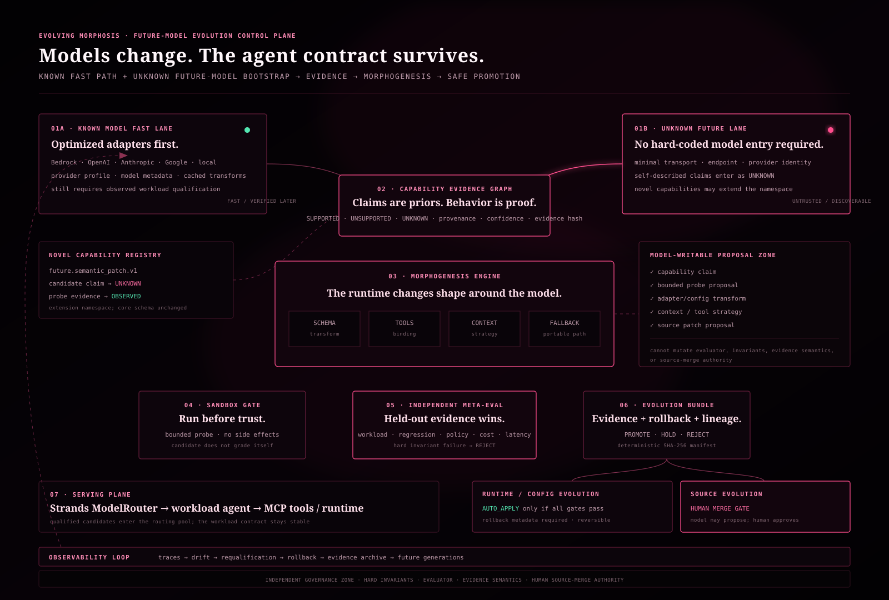

# Evolving Morphosis

A policy-gated model evolution control plane for durable AI agents.

Morphosis discovers model capabilities, verifies them against workload contracts, compiles bounded compatibility adaptations, and promotes qualified model revisions through evidence-backed deployment stages. It is built for long-lived agent systems that need to adopt new models without silently weakening tool, safety, determinism, or rollback guarantees.

## Runtime architecture

Morphosis has four explicit planes.

1. Control plane — FastAPI and Uvicorn service, idempotent commands, structured errors, request IDs, OpenAPI, health, readiness, and Prometheus-style metrics.
2. Evidence plane — tamper-evident SQLite ledger, content-addressed artifacts, capability observations, independent adapter verification, and replayable domain events.
3. Evolution plane — workload contracts, qualification, MorphIR compilation, policy kernel, bundles, shadow, canary, ramp, promotion, and rollback.
4. Projection plane — live SSE-backed console plus deterministic signed replay artifacts for offline inspection.

## What Morphosis does

A candidate model never inherits trust from metadata or self-report.

Morphosis:

- registers a model surface and its claimed capabilities;
- generates or accepts bounded probe proposals;
- executes probes only through host-installed transports;
- records evidence in a hash-chained ledger;
- derives capability state from observed results;
- compiles compatibility transforms through a closed MorphIR instruction set;
- independently verifies the compiled adapter;
- qualifies the candidate against a workload contract;
- creates content-addressed Evolution Bundles with rollback metadata;
- promotes through staged deployment checks;
- accepts telemetry and can trigger requalification or rollback.

Unknown models can enter the system. Unknown does not mean trusted.

## Production service

Create an environment and install dependencies:

    python3.12 -m venv .venv
    .venv/bin/pip install -r requirements.txt

Run the service:

    MORPHOSIS_DB=./var/morphosis.sqlite \
    MORPHOSIS_LOG_LEVEL=info \
    PYTHONPATH=src .venv/bin/python -m morphosis.os.service \
      --host 127.0.0.1 \
      --port 8765

After installing the package, the dedicated executable is:

    pip install .
    morphosis-server --db ./var/morphosis.sqlite --host 127.0.0.1 --port 8765

The compatibility entrypoint python -m morphosis.os.api delegates to the same ASGI runtime.

Operational endpoints:

- GET /healthz — process liveness.
- GET /readyz — SQLite quick-check, ledger integrity, and schema readiness.
- GET /metrics — service and ledger counters.
- GET /docs — OpenAPI UI unless disabled.
- GET /api/v1/system — canonical projection.
- GET /api/v1/events — resumable SSE ledger.
- POST /api/v1/commands — idempotent command boundary.

The UI is served by the same process:

    http://127.0.0.1:8765/?live=1

## Persistence and integrity

Morphosis uses SQLite in WAL mode with:

- explicit schema metadata;
- busy timeout and bounded WAL checkpointing;
- idempotent command records;
- content-addressed artifacts;
- hash-chained domain events;
- reconnect integrity verification;
- graceful checkpoint and close semantics.

The readiness endpoint fails closed if the ledger is not healthy.

## Host-managed model transports

Candidate input cannot grant itself network authority.

External model access is installed by the operator through an exact provider and endpoint binding file. See transport-config.example.json.

Example:

    {
      "bindings": [
        {
          "provider": "example-provider",
          "endpoint": "https://model-bridge.example.com/v1/morphosis/probe",
          "auth_env": "MORPHOSIS_MODEL_BRIDGE_TOKEN",
          "timeout_ms": 5000,
          "cost_per_request_usd": 0.0
        }
      ]
    }

Run with:

    export MORPHOSIS_TRANSPORTS_FILE=./transport-config.json
    export MORPHOSIS_MODEL_BRIDGE_TOKEN=...
    morphosis-server

The bridge receives a morphosis.probe.v1 envelope containing evaluator-owned probe metadata and input, and returns one JSON field named output.

Transport security properties:

- exact provider and endpoint registration;
- HTTPS required except localhost;
- no credentials in URLs;
- optional bearer secret loaded only from an environment variable;
- ambient HTTP proxy configuration disabled;
- redirects denied;
- request and response byte budgets enforced;
- probe timeout bounded by both probe policy and transport configuration.

Reference transports remain available for deterministic verification and CI, but they are not the product boundary.

## Model evolution architecture

The evolution path is:

1. Known-model fast lane — installed adapters for already-understood surfaces.
2. Unknown-model bootstrap — minimal surface registration with claims remaining unverified.
3. Capability evidence graph — namespaced capabilities, confidence, provenance, and evidence hashes.
4. Probe execution boundary — evaluator-owned corpora and host-installed transports.
5. MorphIR compiler — closed data transforms; no eval, import, or source execution.
6. Independent adaptation verification — held-out roundtrip, semantic, and determinism checks.
7. Qualification — workload quality, reliability, latency, cost, and hard-invariant gates.
8. Evolution Bundle — content-addressed change, evidence, rollback, and lineage.
9. Promotion controller — shadow, canary, ramp, promote, rollback.
10. Observability loop — telemetry, drift detection, and requalification.

## Hard boundaries

- Unknown never means supported.
- Self-report never equals proof.
- Candidate cannot decide its own pass or fail.
- Higher aggregate quality cannot compensate for a failed hard invariant.
- Failed evolution never mutates the incumbent.
- Automatic runtime changes require rollback metadata.
- Source-code changes always require explicit human merge approval.
- Evaluator semantics, evidence rules, hard invariants, and merge authority are outside the auto-writable surface.
- Candidate-provided endpoints are inert until an operator installs the exact transport binding.
- Cross-origin command execution is not enabled by default.
- Wildcard CORS is rejected by configuration.

## Future-model proof

The repository includes future-model-x, which advertises the previously unknown capability future.semantic_patch.v1.

The proof demonstrates:

1. UNKNOWN_BOOTSTRAP.
2. Unverified namespaced capability claim.
3. Candidate-proposed bounded probe description.
4. Independent observation.
5. Dynamic capability registration.
6. Compatibility transform compilation.
7. Independent transform verification.
8. Evolution Bundle creation.
9. Runtime auto-apply only when policy allows it.
10. Source evolution still stops at human approval.

Run it:

    PYTHONPATH=src .venv/bin/python -m morphosis.cli \
      --future-model fixtures/future_model_x.json

## Verification

The repository verification suite covers:

- Python domain and persistence tests;
- production ASGI service tests;
- HTTP transport boundary tests;
- real Strands tool loops;
- frontend event and visual determinism;
- generated projection parity;
- schema validation;
- current-model qualification;
- future-model onboarding and adaptation verification.

Run:

    ./verify.sh

Current main verifies 81 Python tests plus 14 frontend/adapter tests and deterministic artifact parity.

## Containers

Build and run:

    docker compose up --build

The container:

- runs as a non-root user;
- persists the ledger under /data;
- exposes port 8765;
- includes a /readyz health check;
- does not enable external model egress unless a transport file is mounted and configured.

## Configuration

See .env.example and transport-config.example.json.

Important variables:

- MORPHOSIS_HOST
- MORPHOSIS_PORT
- MORPHOSIS_DB
- MORPHOSIS_LOG_LEVEL
- MORPHOSIS_REQUEST_MAX_BYTES
- MORPHOSIS_SSE_HEARTBEAT_SECONDS
- MORPHOSIS_ALLOWED_ORIGINS
- MORPHOSIS_TRANSPORTS_FILE
- MORPHOSIS_DISABLE_DOCS

## Strands integration

Morphosis uses the Strands Agents SDK directly. The orchestration layer and HTTP service call the same application command boundary, so HTTP, CLI, and agent-driven evolution cannot silently diverge into separate policy implementations.

The broader Autonomous Morphology research direction predates this repository. Private AM and Animantum identity architecture, private memory systems, and proprietary long-term optimization work are intentionally not part of this public codebase.

## Development status

Version 0.3.0 is a deployable control-plane runtime with persistent state, production ASGI service, deterministic replay, host-managed HTTP transports, container packaging, CI, and end-to-end verification.

The default deployment controller is deliberately local and policy-gated. Cloud-specific rollout controllers can implement the existing deployment protocol without changing qualification or evidence semantics.

## License

MIT

## Deployment adapters

The canonical Morphosis authority is the Python Evolution OS under `src/morphosis/os/`. Platform-specific deployment glue is tracked under `adapters/` and must not redefine qualification, evidence, or promotion policy.

The current public AppDeploy demo uses `adapters/appdeploy/`. Its UI shell is sourced from `site/`; only transport, persistence, realtime projection, and platform QA are adapter-specific. Deterministic fixtures in that adapter are proof/demo fixtures, not external-model telemetry.

## Amazon Bedrock discovery

Morphosis can import the current Amazon Bedrock control-plane catalog without treating provider metadata as evidence. Enable it with `MORPHOSIS_BEDROCK_DISCOVERY=true` and an explicit region through `MORPHOSIS_AWS_REGION` or the standard AWS region environment. Credentials and IAM are owned by the host process; no AWS secret is accepted through the Morphosis command API.

Once enabled, call the normal command boundary with `{"name":"discover","payload":{"provider":"bedrock"}}`. Foundation models and inference profiles are normalized into candidate surfaces whose claims are tagged `provider-catalog-metadata`. They remain `UNKNOWN` until a separate host-bound invocation transport runs independent probes and the normal adaptation/qualification gates pass. Catalog presence, an ACTIVE Bedrock lifecycle/profile status, and streaming/inference-type metadata are never promotion authority.
